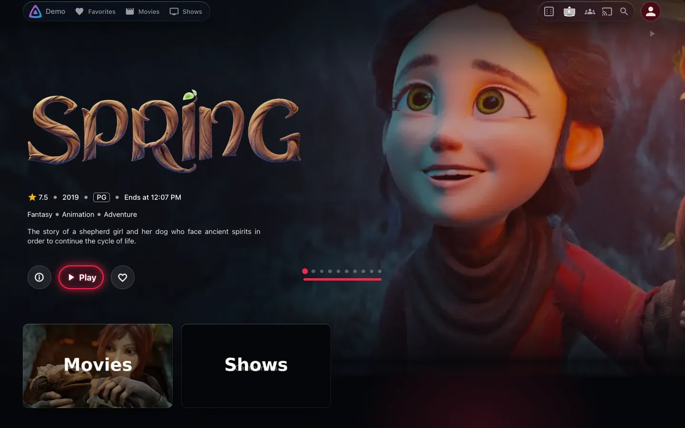
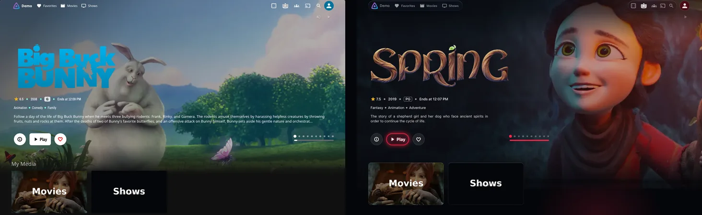
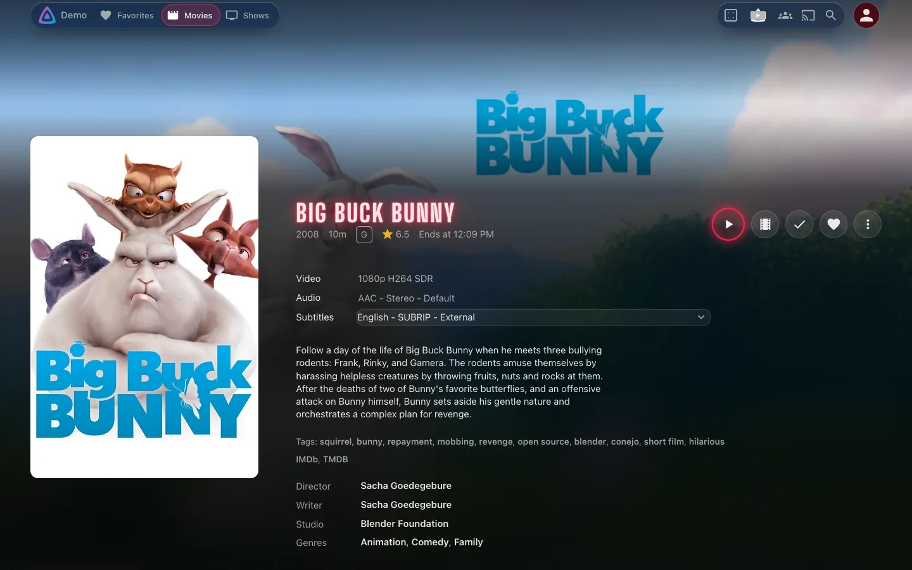
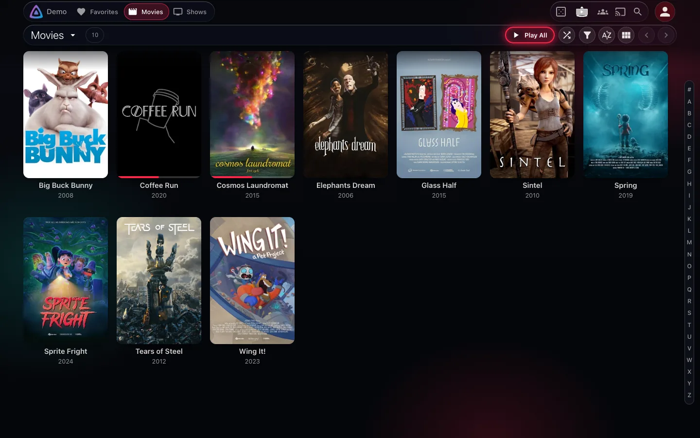
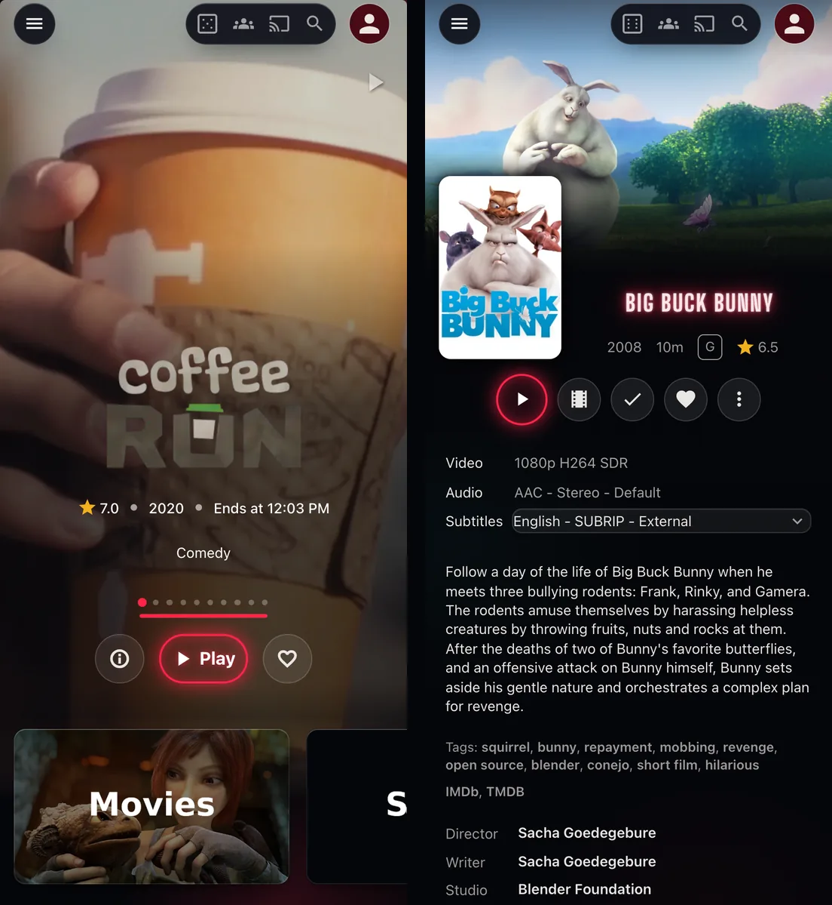
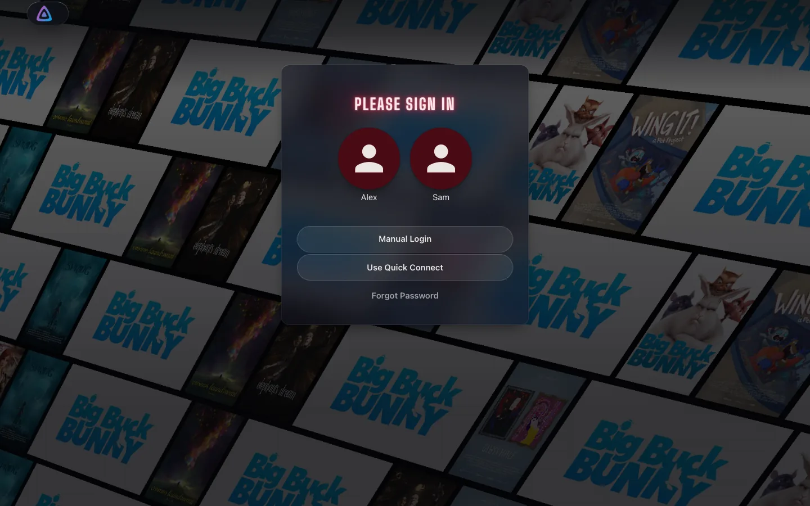
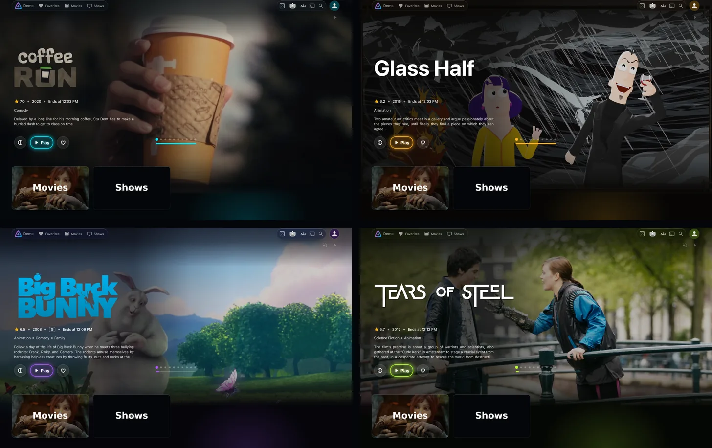
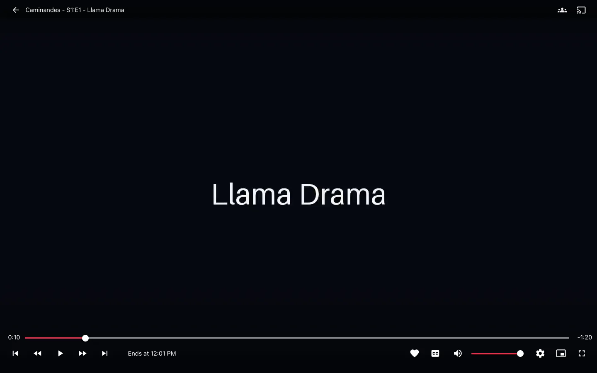

# NeonFin

A glass-and-neon web skin for Jellyfin 12, in one stylesheet.

[](https://github.com/quen-de/NeonFin/actions/workflows/ci.yml)
[](https://github.com/quen-de/NeonFin/releases/latest)



## What it is

- CSS only: no scripts, nothing for the server to install. One file in Jellyfin's Custom CSS.
- Glass where it reads as glass: the header and its menus. Cards, title pages and the player
  stay solid.
- Works with or without the popular plugins (see Compatibility).
- Page load and style cost stay within set limits of plain Jellyfin, measured on every change
  ([how](DEVELOPMENT.md#gates)).
- Every colour comes from nine tokens; four presets are ready.
- Turns solid and still when the system asks for less transparency, more contrast, forced
  colours or less motion.

| | |
|---|---|
|  |  |
|  |  |
|  |  |
|  | |

## Install

In Jellyfin: **Dashboard, Branding, Custom CSS**. Paste one of the two below, save, and reload
the page.

**From jsDelivr**, the simplest. Each viewer's browser then fetches the file from jsDelivr.
The `@import` line must come first in the field, before any other rule, or browsers ignore it.

```css
@import url("https://cdn.jsdelivr.net/gh/quen-de/NeonFin@v1.0.0/dist/neonfin.css");
```

**Pasted in**, the private one: no third party is contacted. Download
[`neonfin.css`](https://github.com/quen-de/NeonFin/releases/latest/download/neonfin.css) from
the latest release and paste its contents into the field.

## Palettes

Every colour comes from nine tokens. Four presets are ready: Cyan neon, Amber, Violet and Acid
green. Add one after the skin, as a second `@import` right after the first:

```css
@import url("https://cdn.jsdelivr.net/gh/quen-de/NeonFin@v1.0.0/dist/neonfin.css");
@import url("https://cdn.jsdelivr.net/gh/quen-de/NeonFin@v1.0.0/palettes/cyan.css");
```

or paste the preset's block after the pasted skin.

To make your own, open
[`palette.html`](https://github.com/quen-de/NeonFin/releases/latest/download/palette.html)
from the latest release in a browser. It previews the skin in your colours, checks that text
stays readable, and gives you the block to paste after the skin.

The nine, with their defaults:

    :root {
      --nf-neon: #ff2448;            /* accent: Play, focus rings, lit titles, progress */
      --nf-on-neon: var(--nf-light); /* labels and ticks drawn on the accent */
      --nf-teal: #19d3c5;            /* second accent, in the background light */
      --nf-ink: #05060a;             /* page background */
      --nf-ink-2: #090b12;           /* raised background */
      --nf-chrome: #121420;          /* header, menus and panels */
      --nf-paper: #f6f3f0;           /* text */
      --nf-light: #fff;              /* highlights, rims and washes */
      --nf-shade: #000;              /* shadows */
    }

A light accent needs dark labels: the cyan, amber and acid green presets set
`--nf-on-neon: #000`. The defaults keep every label readable over the brightest artwork. A
lighter ink or chrome, or a darker paper, can cost that; the picker shows where.

## Compatibility

- Jellyfin 12, tested on `jellyfin/jellyfin:12.2.20261005-225228`, in the modern layout.
- Chrome is tested on every change (Edge shares its engine), at desktop and phone sizes;
  Firefox and Safari are checked at each release. On phones the targets are Chrome on
  Android and the Jellyfin Android app, which runs the web client; neither is tested on a
  device.
- Plugins, each optional:

| Plugin | Tested version | Styled |
|---|---|---|
| File Transformation | 3.0.2.0 | Required by the IAmParadox plugins |
| Plugin Pages | 3.0.2.0 | Hosts Jellyfin Enhanced's calendar |
| Home Screen Sections | 3.0.3.0 | Its rows and Discover cards |
| Custom Tabs | 0.3.2.0 | Works alongside; nothing of its own to style |
| Media Bar Enhanced | 3.10.0.0 | The hero: slides, dots or counter, buttons |
| Jellyfin Enhanced | 12.13.0.0 | Its panel, calendar, flags, random pick and Seerr search |

## Known limitations

- The legacy layout is not styled; use the modern one (the default).
- TV apps, and phone apps that do not run the web client, do not load custom CSS.
- Media Bar Enhanced's stylesheet imports a web font from Google. The skin sets the hero in
  its own face, so the font is never downloaded, but the import still is. The original Media
  Bar plugin is not supported.
- Seerr's surfaces in Jellyfin Enhanced are styled but not on the demo server, so they are
  checked less often.
- Media Bar Enhanced has no Jellyfin 12 build yet: its 3.10.0.0 build targets Jellyfin 10.11.
  It loads on Jellyfin 12.2, and NeonFin was tested with it there.

## Update

Change the version in the `@import` URL, or paste the new file. A new major version can rename
palette tokens: read the [changelog](CHANGELOG.md) before moving to one.

To take every 1.x release without editing anything, import the major version instead (the
same works for the palette URLs). jsDelivr can keep serving the previous release for a while
after a new one.

```css
@import url("https://cdn.jsdelivr.net/gh/quen-de/NeonFin@1/dist/neonfin.css");
```

## Uninstall

Remove the NeonFin lines from Custom CSS, save, and hard-reload (Ctrl+Shift+R, or Cmd+Shift+R
on a Mac): clients keep the old stylesheet until they reload.

## Contributing

Bug reports and fixes are welcome: see [CONTRIBUTING.md](CONTRIBUTING.md). The
[demo server](DEVELOPMENT.md#demo-server) runs Jellyfin with the plugins and a library of open
movies on your own machine, so you can test against the same pages the screenshots show.

## Credits and licence

MIT. The embedded sign font is a subset of Big Shoulders Display, under the SIL Open Font
License 1.1 (`skin/fonts/OFL.txt`). The films and artwork in the screenshots are open movies
by the Blender Foundation, under Creative Commons Attribution licences, with metadata from TMDB
([demo/CREDITS.md](demo/CREDITS.md)). NeonFin is not affiliated with the Jellyfin project.
