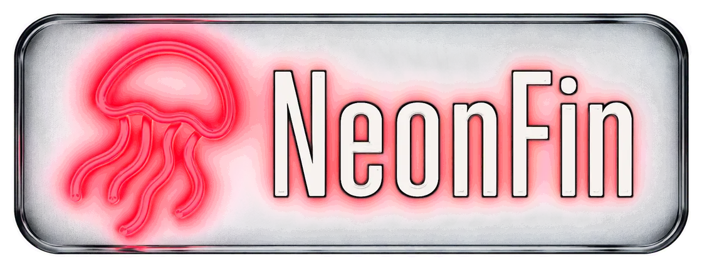

<h1>
  <picture>
    <source media="(prefers-color-scheme: dark)" srcset="docs/brand/header-dark.webp">
    
  </picture>
</h1>

A configurable glass-and-neon web skin for Jellyfin 12.

[](https://github.com/quen-de/NeonFin/actions/workflows/ci.yml)
[](https://github.com/quen-de/NeonFin/releases/latest)


NeonFin proposes a balance between pure glass and neon themes, which I think was missing from the landscape. Performance was benchmarked throughout to keep it close to vanilla Jellyfin. 

**⚠️ OBLIGATORY AI DISCLAIMER**

I wouldn't have had the time to do it without Claude Code. I'm not a UI/UX designer, but I am a software developer, and the project follows proper DevOps practices, using a demo server to run tests and benchmarks.

## Features

- **Neon and glass.** A dark interface lit by one neon accent. Glass where it reads as glass, on the header and its menus over the artwork; cards, title pages and the player stay solid and sharp.
- **Performance-aware.** Glass and glow cost render time, so every effect is deliberate: page load, style work and scrolling are measured against plain Jellyfin on the same server and stay within set limits ([how](DEVELOPMENT.md#gates)).
- **Your colours.** Four ready palettes (Cyan neon, Amber, Violet, Acid green), or your own:
  a picker page previews it and checks that text stays readable.
- **Works with popular plugins**, each optional, and complete without them:
  [Media Bar Enhanced](https://github.com/CodeDevMLH/jellyfin-plugin-media-bar-enhanced),
  [Home Screen Sections](https://github.com/IAmParadox27/jellyfin-plugin-home-sections),
  [Jellyfin Enhanced](https://github.com/n00bcodr/Jellyfin-Enhanced),
  [Custom Tabs](https://github.com/IAmParadox27/jellyfin-plugin-custom-tabs) and
  [Plugin Pages](https://github.com/IAmParadox27/jellyfin-plugin-pages).
- **Desktop and phone** layouts, from the sign-in page to the player.
- **Accessible.** Turns solid and still when the system asks for less transparency, more
  contrast, forced colours or less motion.
- **Nothing to install on the server.** CSS only, no scripts: one line in Jellyfin's Custom
  CSS to add it, and the same line to remove.

| | |
|---|---|
|  |  |
|  |  |
|  |  |

## Install

NeonFin works on Jellyfin 12. It is one line of CSS, which you can add for everyone on the
server or just for yourself.

```css
/* Stays up to date with every 1.x release */
@import url("https://cdn.jsdelivr.net/gh/quen-de/NeonFin@1/dist/neonfin.css");
```

To stay on this exact version instead, use `@v1.0.0` in place of `@1`.

**For everyone**, with an administrator account:

1. In Jellyfin, open **Dashboard**, then **Branding**.
2. Paste the line into **Custom CSS**, first in the field: browsers ignore an `@import` that
   comes after any other rule. Remove any other theme's lines.
3. Save, and reload the page.

**Just for you**, with any account. This applies to the one browser or app you set it in:

1. In Jellyfin, open **Settings** from your user menu, then **Display**.
2. Paste the line into **Custom CSS code**, first in the field. If the server already has a
   theme, also tick **Disable server-provided custom CSS code**.
3. Save, and reload the page.

Viewers' browsers then fetch the skin from jsDelivr, a free public CDN. To keep everything on
your own server instead, download
[`neonfin.css`](https://github.com/quen-de/NeonFin/releases/latest/download/neonfin.css) from
the latest release and paste its contents into the field in place of the line.

## Change the colours

Add a palette's line right after the skin's:

```css
@import url("https://cdn.jsdelivr.net/gh/quen-de/NeonFin@1/dist/neonfin.css");
@import url("https://cdn.jsdelivr.net/gh/quen-de/NeonFin@1/palettes/cyan.css");
```

The palettes are `cyan`, `amber`, `violet` and `acid`. If you pasted the skin in, paste the
palette file's contents after it instead.

To make your own, open
[`palette.html`](https://github.com/quen-de/NeonFin/releases/latest/download/palette.html)
from the latest release in a browser. It previews the skin in your colours, checks that text
stays readable, and gives you the block to paste after the skin.

<details>
<summary>The nine colour tokens, with their defaults</summary>

```css
:root {
  --nf-neon: #ff2448;            /* accent: Play, focus rings, lit titles, progress */
  --nf-on-neon: var(--nf-light); /* labels and ticks drawn on the accent */
  --nf-teal: #19d3c5;            /* second accent, in the background light */
  --nf-ink: #05060a;             /* page background */
  --nf-ink-2: #090b12;           /* raised background */
  --nf-chrome: #121420;          /* header, menus and panels */
  --nf-paper: #f6f3f0;           /* text */
  --nf-light: #fff;              /* highlights, rims and washes */
  --nf-shade: #000;              /* shadows */
}
```

A light accent needs dark labels: the cyan, amber and acid green palettes set
`--nf-on-neon: #000`. The defaults keep every label readable over the brightest artwork. A
lighter ink or chrome, or a darker paper, can cost that; the picker shows where.

</details>

## Compatibility

- Jellyfin 12, tested on `jellyfin/jellyfin:12.2.20261005-225228`, in the modern layout.
- Chrome is tested on every change (Edge shares its engine), at desktop and phone sizes;
  Firefox and Safari are checked at each release. On phones the targets are Chrome on
  Android and the Jellyfin Android app, which runs the web client.
- Plugins, each optional:

| Plugin | Tested version | Styled |
|---|---|---|
| File Transformation | 3.0.2.0 | Required by the IAmParadox plugins |
| Plugin Pages | 3.0.2.0 | Hosts Jellyfin Enhanced's calendar |
| Home Screen Sections | 3.0.3.0 | Its rows and Discover cards |
| Custom Tabs | 0.3.2.0 | Its tabs, which take a plain icon |
| Media Bar Enhanced | 3.10.0.0 | The hero: slides, dots or counter, buttons |
| Jellyfin Enhanced | 12.13.0.0 | Its panel, calendar, flags, random pick and Seerr search |

## Known limitations

- The legacy layout is not styled; use the modern one (the default).
- Media Bar Enhanced's stylesheet imports a web font from Google. The skin sets the hero in its own face, so the font is never downloaded, but the import still is. The original Media Bar plugin is not supported for now (its slider was broken, haven't taken the time to propose an upstream PR to fix).
- Seerr's surfaces in Jellyfin Enhanced are styled (verified on my personal server) but not on the demo server, so they are checked less often.
- Media Bar Enhanced has no Jellyfin 12 build yet: its 3.10.0.0 build targets Jellyfin 10.11. It loads on Jellyfin 12.2, and NeonFin was tested with it there.

## Update

- With `@1`, there is nothing to do: each 1.x release reaches you on its own, though jsDelivr
  can keep serving the previous one for a while after a release.
- With a pinned version such as `@v1.0.0`, change the version in each line, or paste the new
  file.

## Uninstall

Remove the NeonFin lines from the Custom CSS field you used, save, and hard-reload (Ctrl+Shift+R, or Cmd+Shift+R on a Mac): clients keep the old stylesheet until they reload.

## Contributing

Bug reports and fixes are welcome: see [CONTRIBUTING.md](CONTRIBUTING.md).

### Why a Python harness for a stylesheet?!

A stylesheet has no compiler to catch its mistakes, and Jellyfin's web client offers it no stable API: class names move between releases, and a rule that looks right on one page can
slow another down or break a plugin's layout. Screenshots alone do not show that, so every change is checked on real pages. A harness built on pytest and Playwright opens a Jellyfin
server in Chrome with the local build injected, and compares each page with plain Jellyfin: the work it takes to render and scroll, whether text keeps its contrast, whether any of Jellyfin's default blue is left, and whether glass stays where it belongs.

It is Python because that is what I work with. The harness runs on Playwright and Pillow, while the build itself uses only Python's standard library, so producing one CSS file needs no Node toolchain. The
[demo server](DEVELOPMENT.md#demo-server) runs Jellyfin with the plugins and a library of open movies on your own machine, so you can test against the same pages the screenshots show.
[DEVELOPMENT.md](DEVELOPMENT.md) has the rest.

## Credits and licence

MIT. The embedded sign font is a subset of Big Shoulders Display, under the SIL Open Font License 1.1 (`skin/fonts/OFL.txt`). The films and artwork in the screenshots are open movies by the Blender Foundation, under Creative Commons Attribution licences, with metadata from TMDB
([demo/CREDITS.md](demo/CREDITS.md)). NeonFin is not affiliated with the Jellyfin project.
